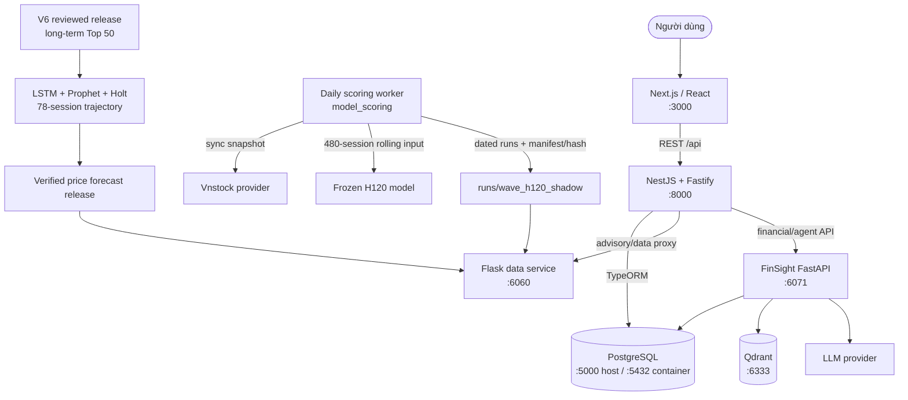
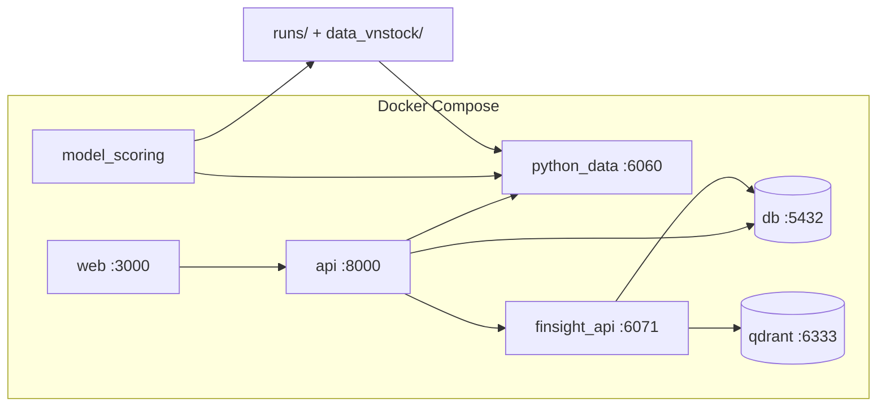

# Kiến trúc hệ thống

## Tổng quan

Fireant gồm frontend Next.js, backend nghiệp vụ NestJS, dịch vụ dữ liệu
Flask/Vnstock và FinSight FastAPI. PostgreSQL là kho dữ liệu nghiệp vụ; Qdrant
phục vụ embedding/vector search cho FinSight. Artifact ML được ghi theo
release/run có manifest và hash để API chỉ phục vụ kết quả đã xác minh.

## Sơ đồ tổng thể

## Thành phần

### Frontend

- Next.js 16, React 19; chạy local/Compose trên cổng `3000`.
- Gọi NestJS qua `/api`; không gọi trực tiếp model worker hay FastAPI agent.
- Hiển thị H120, V6 và quỹ đạo giá 78 phiên từ các endpoint advisory.

### Backend chính

- NestJS 11 với Fastify, TypeORM và JWT/cookie authentication.
- Cổng mặc định `8000`, global prefix `/api`.
- Chịu trách nhiệm auth, users, stocks, industries, news, recommendations,
  payments và proxy/validation cho các API advisory.

### Flask data service

- Chạy cổng `6060`, cung cấp market data và artifact advisory cho NestJS và cho
  trình duyệt qua đường dẫn cùng origin `/python_api/*` (Next.js rewrite khi dev,
  nginx khi production).
- Dữ liệu thị trường lấy từ vnstock bản free (nguồn KBS/VCI) qua một client duy
  nhất `python_data/core/vnstock_client.py`, tự chuyển nguồn khi một nguồn lỗi.
- Endpoint advisory: `/api/wave-h120/latest`, `/api/wave-h120/<symbol>`,
  `/api/wave-v6/latest`, `/api/wave-v6/<symbol>`.
- Chỉ chấp nhận manifest/release hợp lệ và chọn newest valid result; run lỗi hoặc
  bị thay đổi hash được bỏ qua để dùng fallback trước đó.

### FinSight API và vector store

- FinSight FastAPI chạy cổng `6071`, dùng PostgreSQL và Qdrant `6333`.
- Qdrant lưu embedding/vector search; không lưu snapshot OHLCV hoặc artifact H120/V6.

### ML workers và vòng đời model

#### H120 — ngắn hạn

- `model_scoring` chạy vào `WAVE_DAILY_SCORING_TIME` (mặc định 19:00, giờ Việt
  Nam) vào ngày thị trường.
- Đồng bộ snapshot mới, giữ rolling history tối đa 480 phiên, tạo feature riêng
  và chạy frozen H120 inference; không retrain.
- Ghi run có ngày, manifest, output hash và model-bundle hash vào
  `runs/wave_h120_shadow/`.
- API phục vụ newest valid run; run failed/tampered không thay thế kết quả hợp lệ
  trước đó.

#### V6 — dài hạn

- Long-term ensemble được train/review/promote theo release bất biến.
- V6 độc lập với H120: không dùng H120 feature hoặc xác suất.
- Cohort Top 50 của release là nguồn đầu vào duy nhất cho nhánh dự báo giá.

#### LSTM price trajectory

- Kết hợp LSTM, additive Prophet và additive Holt-Winters cho cohort Top 50 V6.
- Dự báo quỹ đạo giá trong 78 phiên tiếp theo.
- Chỉ refresh khi V6 cohort/release được promote; không chạy trong daily H120
  scoring. Artifact phải hoàn chỉnh và hash hợp lệ trước khi thay release đang phục vụ.

## Luồng dữ liệu vận hành

1. Worker đồng bộ snapshot OHLCV từ provider và cắt theo ngày giao dịch.
2. Adapter gộp dữ liệu với rolling cache, deduplicate và giữ 480 phiên mới nhất.
3. Frozen H120 model tạo output; worker ghi manifest và chỉ promote run thành công.
4. Flask chọn newest valid H120/V6/LSTM artifact và cung cấp JSON.
5. NestJS proxy/kiểm tra response rồi trả về Next.js.
6. Nếu run mới failed hoặc không hợp lệ, serving pointer vẫn trỏ tới kết quả hợp lệ gần nhất.

## Deployment bằng Docker Compose

Local Compose dùng `docker-compose.yml` và `.env`. Production dùng compose cùng
`.env` của VPS; cần giữ đúng các volume `runs/`, `data_vnstock/`, `deploy/` và
biến provider tương ứng. Không hard-code ngày 27/08: H120 dùng snapshot ngày worker
đang xử lý, còn V6/LSTM dùng release được promote.

## Bảo mật và tính toàn vẹn

- Secret/API key chỉ nằm trong `.env` của môi trường triển khai, không commit.
- JWT/cookie được ký bằng secret riêng; CORS giới hạn theo domain frontend.
- Artifact serving phải có manifest, hash và trạng thái thành công.
- `trade_authorized` của daily advisory mặc định là `false`; output chỉ mang tính tham khảo.

## Tài liệu liên quan

- [Daily independent model scoring](docs/daily_independent_model_scoring.md)
- [Architecture diagram](docs/architecture_diagram.md)
