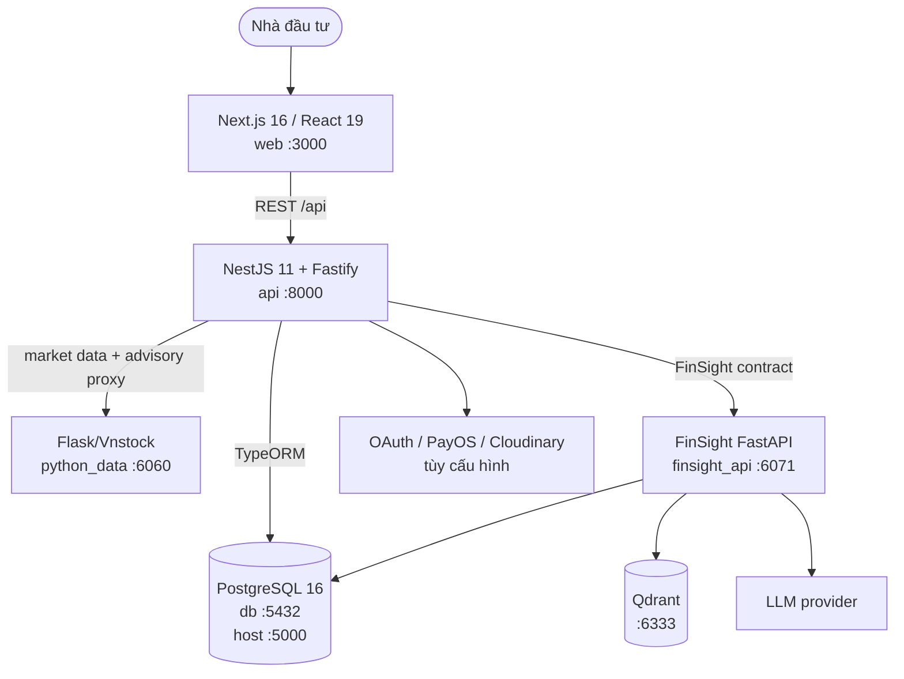
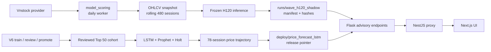
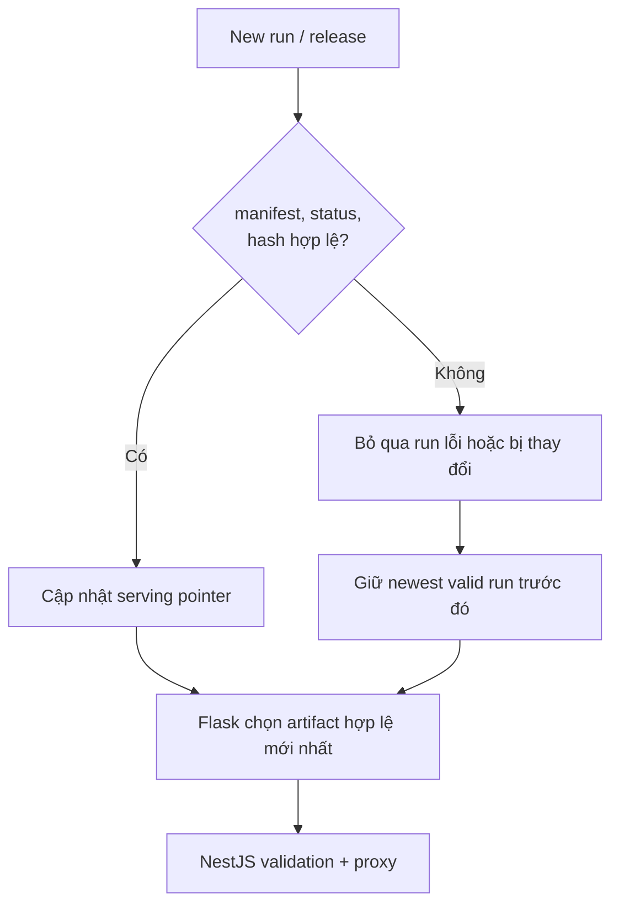

# Sơ đồ kiến trúc P-238 (Fireant / FinSight)

Tài liệu này mô tả kiến trúc trong repository và deployment bằng
`docker-compose.yml`. Trình duyệt chỉ gọi NestJS; NestJS là lớp API và proxy
chính cho dữ liệu thị trường, advisory và trợ lý AI.

## Runtime topology

## NestJS application boundary

NestJS gom các nghiệp vụ authentication, users, stocks, industries, news,
community, premium orders, upload, stock recommendations, stock prediction,
AI Stock và hai endpoint advisory Wave H120/V6. Các module này dùng PostgreSQL
cho dữ liệu nghiệp vụ; các module market/advisory gọi `python_data` qua HTTP.

## Data and model lifecycle

H120 và V6 là hai nhánh độc lập. Worker chỉ chạy inference H120 theo lịch
`WAVE_DAILY_SCORING_TIME` (mặc định 19:00 giờ Việt Nam), không retrain và
không dùng feature/probability của V6. Nhánh LSTM chỉ refresh sau khi release
V6 và cohort Top 50 được promote.

## Serving and fallback contract

- H120 được phục vụ từ run hợp lệ dưới `runs/wave_h120_shadow/`.
- V6 dùng release pointer dưới `deploy/wave_v6_advisory/`.
- Price forecast dùng release pointer dưới `deploy/price_forecast_lstm/`.
- Qdrant chỉ lưu embedding/vector search cho FinSight, không lưu OHLCV hay
  artifact model.

## Docker Compose services

| Service | Port | Vai trò |
|---|---:|---|
| `web` | `3000` | Frontend và server-side rewrite tới `api` |
| `api` | `8000` | API nghiệp vụ, auth và proxy |
| `python_data` | `6060` | Market data và advisory artifacts |
| `finsight_api` | `6071` | Financial agent, PostgreSQL/Qdrant/LLM |
| `db` | `5000:5432` | PostgreSQL |
| `qdrant` | `6333` | Vector store |
| `model_scoring` | không expose | Daily H120 sync/inference |
| `ngrok` | `4040` | Tùy chọn tunnel |

Lưu ý: trong Compose hiện tại, `api` và `finsight_api` kết nối PostgreSQL
qua `host.docker.internal` và `VPS_DB_LOCAL_PORT` (mặc định `5434`), còn
service `db` publish cổng host `5000`. Khi đổi deployment cần đồng bộ các
biến kết nối này.

## Native agent (optional)

`src/main.py` là FastAPI LangGraph agent độc lập, chạy bằng
`uvicorn src.main:app --port 8090`, với `/health` và `/api/v1/*`. Đây không phải
service `finsight_api` trong Compose (`6071`); frontend vẫn đi qua NestJS.
